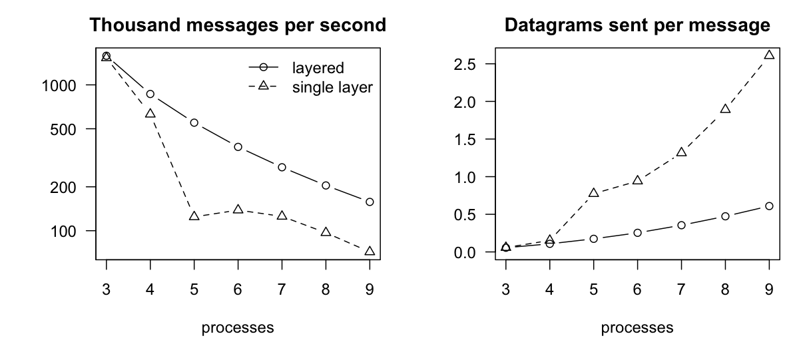
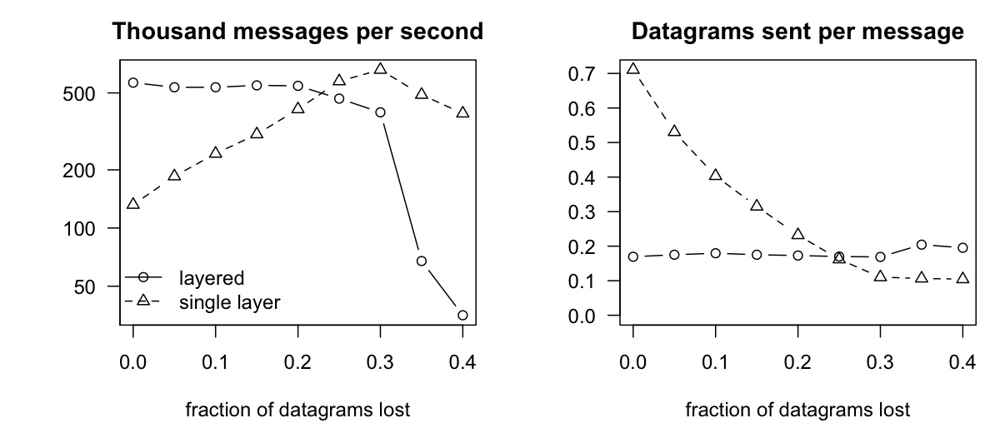

# Lattice Agreement

Perfect links, FIFO uniform reliable broadcast and lattice agreement over UDP, written in C++17.

| Program | Abstraction | Implementation |
|---|---|---|
| `links` | [Perfect links][pl] | Sequence numbers and per-message ACKs. Fast retransmit and an adaptive timeout, as in TCP. |
| `broadcast` | [FIFO uniform reliable broadcast][furb] | Three layers over perfect links: [best-effort][beb], [majority-ack][urb], [sequence numbers][fifo]. |
| `broadcast --fused` | [FIFO uniform reliable broadcast][furb] | One layer over raw UDP. Each message carries its ACK set and is resent every 20 ms. |
| `lattice` | [Lattice agreement][la] | [Proposer-acceptor][pa] over perfect links. One instance per input line. |

## Usage

    make
    bin/broadcast 1 localhost:9001 localhost:9002 localhost:9003

Start one process per address. Each reads lines from standard input and prints what it delivers.

- `links`: a line `ID text` sends `text` to process `ID`.
- `broadcast`: every line is broadcast.
- `lattice`: every line is a proposal, a set of words.

`--loss 0.1` drops a tenth of the datagrams a process sends.

`bench/run.py` runs a group on one machine under loss, pauses and crashes. It checks every output against the properties of the abstraction.

    bench/run.py broadcast -n 5 -m 100000 --loss 0.1 --pause --crash 2

## Benchmark

Layered against single-layer broadcast. Apple M1 Pro, loopback, median of three runs.

- Layered throughput falls with n². Every message crosses every pair of processes.
- From five processes on, the single layer sends four times as many datagrams. Its 20 ms resend fires before the acknowledgements return.

Five processes, each dropping a fraction of its outgoing datagrams. Dropped
datagrams are not counted as sent.

- Up to 20% loss the layered broadcast holds. Fast retransmit recovers a lost datagram without a timeout.
- Past 30% it collapses. The timeout doubles on every expiry, as in TCP. The links treat loss as congestion.
- The single layer never waits longer than 20 ms. Loss thins out its redundant resends, and it peaks at 30%.

All programs, five processes:

| | no loss | 20% loss |
|---|---:|---:|
| `links`, messages/s | 1,990,000 | 1,240,000 |
| `broadcast`, messages/s | 565,000 | 544,000 |
| `broadcast --fused`, messages/s | 132,000 | 412,000 |
| `lattice`, instances/s | 480 | 649 |

Reproduciable with `bench/bench.py && Rscript bench/plot.R`.

[pl]: https://chutommy.com/dist-algorithms#perfect-links
[furb]: https://chutommy.com/dist-algorithms#fifo-uniform-broadcast
[beb]: https://chutommy.com/dist-algorithms#best-effort-broadcast/basic-broadcast
[urb]: https://chutommy.com/dist-algorithms#uniform-reliable-broadcast/majority-ack-uniform-reliable-broadcast
[fifo]: https://chutommy.com/dist-algorithms#fifo-uniform-broadcast/broadcast-with-sequence-number
[la]: https://chutommy.com/dist-algorithms#lattice-agreement
[pa]: https://chutommy.com/dist-algorithms#lattice-agreement/proposer-acceptor-lattice-agreement
